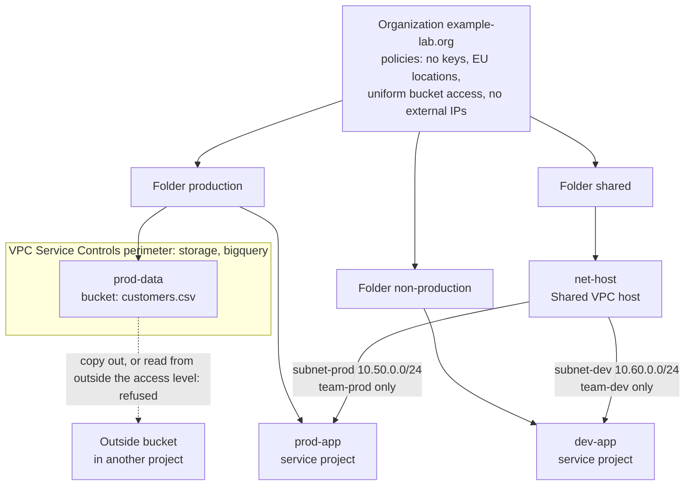

# Architecture

A slice of a landing zone in an organization you own: three folders and four projects, four organization policies set at the top, a shared VPC whose subnets each belong to one team, and a VPC Service Controls perimeter around the project that holds sensitive data. All of it is Terraform, driven by two YAML files, and every policy and perimeter change goes through dry-run mode before it is enforced. A small Python tool checks the design and simulates which control would stop a request.

## Components

| Component | Owns | Defined in |
| --- | --- | --- |
| **Organization** `example-lab.org` | The top of the hierarchy and the organization policies. | You bring it (a free Cloud Identity domain). |
| **Folders** `production`, `non-production`, `shared` | Grouping, and the place a folder-level policy exception would sit. | `modules/folders` |
| **Projects** `prod-data` (the data), `prod-app` (production app), `dev-app` (development app), `net-host` (shared VPC host) | One workload or one shared service each; no default network; APIs per role. | `modules/project` |
| **Organization policies** | The four guardrails, each with a reason and the request it blocks. | `policies/org-policies.yaml`, `modules/org-policies` |
| **Shared VPC** in `net-host` | One network, two subnets (`subnet-prod` 10.50.0.0/24, `subnet-dev` 10.60.0.0/24 in `europe-west1`), service projects attached, `networkUser` on each subnet for its own team only, a logged deny-all ingress rule. | `design/landing-zone.yaml`, `modules/shared-vpc` |
| **VPC Service Controls perimeter** `sensitive_data` | A boundary around `prod-data`, restricting Cloud Storage and BigQuery, with one access level `office`. | `modules/perimeter` |
| **Sensitive bucket** | `prod-data-sensitive` holding the made-up `customers.csv`; readable by the data reader only. | `modules/sensitive-bucket`, `data/customers.csv` |
| **Test identities** | `team-prod-tester`, `team-dev-tester`, `data-reader`: keyless service accounts the operator impersonates, so every proof runs as the identity under test. | `modules/lab-identities` |
| **`landing-zone` tool** | Checks the design and policies, explains the policies, renders them for `gcloud`, simulates the lesson's requests. | `src/landing_zone` |

## The hierarchy and the controls



One request, end to end, for the lesson's attack:

1. A principal that holds `roles/storage.objectViewer` on `prod-data-sensitive` (the `data-reader` identity) runs `gcloud storage cp gs://prod-data-sensitive-SUFFIX/customers.csv gs://some-bucket-outside/`.
2. **IAM** looks at the principal and the bucket: the read is allowed.
3. **The perimeter** looks at where the data is going: the source project is inside, the destination project is outside, so the call is a `RESOURCES_NOT_IN_SAME_SERVICE_PERIMETER` violation. With the perimeter enforced, Cloud Storage answers `403 Request is prohibited by organization's policy` with a `vpcServiceControlsUniqueIdentifier`. In dry-run mode the copy succeeds and the same violation is written to the audit log.
4. The second attack, a read from a machine that matches no access level, is the same flow with the reason `NO_MATCHING_ACCESS_LEVEL`.
5. A principal with **no** read role is stopped at step 2 by IAM, and the perimeter is never consulted, which is why the attack must run as a principal that can read.

## Pattern: a configuration-as-data core with a rules model beside it

Terraform is the system. The Python package is a model of the same design, in four layers enforced by import-linter:

```text
interfaces      cli.py: check, explain, render-policies, simulate
infrastructure  yaml_files.py: reads the design, the policies and the scenarios; writes policy documents
application     check, render (policy documents and the explanation table), scenarios (run and compare)
domain          Design, OrgPolicy, the Request types, Landscape (the decision rules), Decision
```

The domain and application layers read no files, parse no YAML and print nothing (a second contract forbids `pathlib`, `yaml`, `json`, `argparse` and `subprocess` there), so the decision rules are tested on plain values and on the real files through fixtures. The YAML files are the contract between the two halves: Terraform reads them with `yamldecode`, the tool with PyYAML, and tests compare the literals in the Terraform tests with the design file.

## Decisions and trade-offs

| Decision | Why | Cost |
| --- | --- | --- |
| **Policies at the organization, exceptions at folder level** | The guardrails apply to every project; a team that needs an exception gets a folder-level entry in the same file, with a reason, reviewed in a pull request. | Folder policies replace the organization's for that folder; the file records both. |
| **`networkUser` on the subnet, never the host project** | A grant on the project gives every subnet. The lesson's "team A can't create in team B's subnet" depends on this. | One binding per team and subnet; keys use the position in the list so they are known at plan time. |
| **Dry run first, enforced by a variable** | A perimeter blocks calls IAM allows. `spec` is always written, `status` only when enforced; each policy always has a `dry_run_spec`. | Two applies per change and, for the perimeter, up to 30 minutes of propagation. |
| **Perimeter around `prod-data` only** | A bigger perimeter blocks more legitimate traffic. | The service projects are outside, so their VMs reach the bucket through an access level or an ingress rule you add. |
| **An access level on a documentation range** | Your laptop matches nothing, so step 5's second attack fails from the laptop as the lesson shows. | After enforcement Terraform cannot read the bucket from the laptop either; the teardown relaxes the perimeter first, and the notes say to run Terraform from inside an access level. |
| **Keyless test identities, impersonated** | The proofs run as the identity under test, not as the organization admin, and no key is created (the key policy would refuse it anyway). | The operator holds `serviceAccountTokenCreator` on three lab accounts; they are deleted with the lab. |
| **Project and bucket names get a suffix** | Project ids and bucket names are global. | `locals` in the environment derive every name from the design plus `name_suffix`. |
| **A quota project (`lz-bootstrap-SUFFIX`)** | Organization policy and Access Context Manager calls are charged to a project, which must exist before Terraform runs. | One extra project created by `scripts/bootstrap.sh`. |
| **A simulator in Python** | Answers "which control stops this?" in CI without an organization (ADR 3). | A model, not the service; it covers the lesson's rules only. |

## Failure modes the lesson teaches and where the repository shows them

| Failure | Where to see it |
| --- | --- |
| Policy with no reason, then an exception nobody can defend | `OrgPolicy` rejects an entry without a reason and a blocked request; `landing-zone explain` prints both for every policy. |
| `networkUser` on the host project | A test fails if the role is granted anywhere but on a subnet; `make simulate` has the team-prod-in-team-dev's-subnet scenario. |
| Enforcing the perimeter without a dry run | Both modes default to `dry_run`; `scripts/enforce.sh` asks for confirmation; the Terraform tests assert the switch; `make simulate` runs both modes. |
| Treating the perimeter as a replacement for IAM | `Landscape` answers IAM first; the scenario "a principal without a read role reads customers.csv" is stopped by `iam`. |
| Testing the attack as a principal with no read permission | The attack runs as `data-reader`, which holds `objectViewer` on the bucket. |
| Forgetting propagation time | `scripts/enforce.sh` and the operating notes say up to 30 minutes; `teardown.sh` waits after relaxing the perimeter. |
| Policies kept in the console only | The policies are `policies/org-policies.yaml`; Terraform and the tool read it; a test compares them. |

## Limits of the teaching build against a production one

- **Nothing here has run against an organization.** The design, policies and scenarios are checked and simulated; the Terraform is validated, planned offline and tested against a mock provider. The refusals, the dry-run log lines and the violation identifiers need the organization.
- One environment, local state, one pipeline-less operator. A real landing zone splits stacks (organization policies, folders and projects, networking, perimeters), applies each from a pipeline with its own service account, and keeps the state in a locked bucket.
- No hierarchical firewall policy, no centralized log sink, no tag-based policies, no billing export, no VPC flow log analysis, no DNS or Cloud NAT. The stretch goals list three of them.
- The perimeter has one access level on an IP range. Production uses device and identity conditions and ingress and egress rules per service project.
- The lab identities hold project-level `compute.instanceAdmin.v1` so a test VM can be created; no real team would.
- The simulator models four constraints, one subnet rule and two violation reasons. It is a teaching aid for the question, not an implementation of the services.

## Extending it

- **A perimeter bridge** (stretch 1): add a second perimeter (a second project in the design) and a `google_access_context_manager_service_perimeter` with `perimeter_type = "PERIMETER_TYPE_BRIDGE"`; add scenarios to show what it allows, then extend `Landscape._copy` to know bridges.
- **Hierarchical firewall policies** (stretch 2): add `google_compute_firewall_policy` and an association on the `production` and `non-production` folders in a new module; teams cannot override it.
- **A locked log sink** (stretch 3): a new `security` project, a log bucket with a locked retention policy and an aggregated organization sink; add the project to the design file so `check` knows it.
- **A new policy**: add an entry with a reason and a blocked request, add a scenario, run `make design simulate`, apply in dry run.
