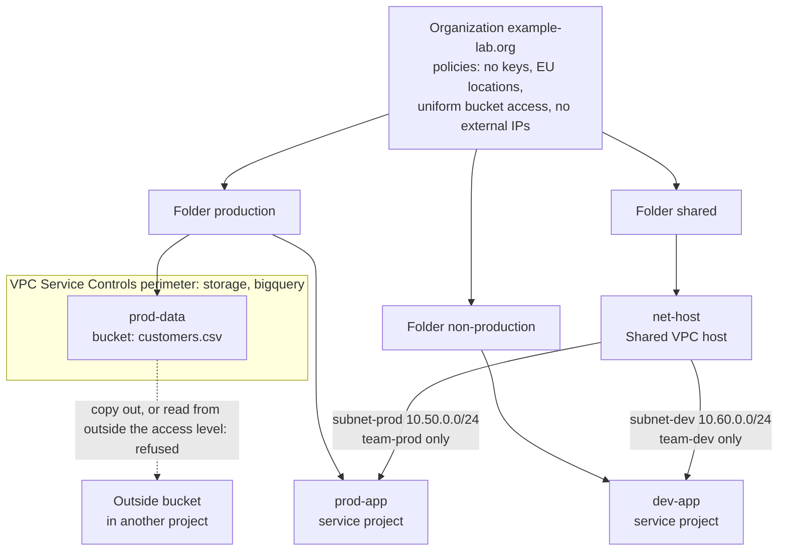

# Mermaid diagrams

## 1. What it is

Mermaid is a small language for drawing diagrams with text. You write boxes and arrows as lines of text inside a Markdown code block marked `mermaid`, and a renderer draws the picture. GitHub renders such blocks in README and other Markdown files automatically. The advantage over a picture file is that the diagram is text: it can be reviewed in a pull request, searched, and kept in step with the code.

## 2. Why this repository uses it

The lesson shows a diagram of the landing zone, and the repository rule says the lesson's diagram and `ARCHITECTURE.md` must agree on component names. The diagram in `ARCHITECTURE.md` is the repository's version: the organization at the top, three folders, four projects, the network host, the perimeter and the blocked path out.

## 3. Where it appears

| Path | What it does |
| --- | --- |
| `ARCHITECTURE.md` | One `mermaid` block in the section "The hierarchy and the controls". |

## 4. How it works underneath

Nothing is installed or run in the repository. When a page is shown, the renderer in your browser (GitHub includes one) reads the block and draws SVG shapes. A diagram starts with its type and direction: `flowchart TB` is a flow chart laid out top to bottom (`LR` would be left to right). After that:

- `id["label"]` declares a node (a box). `id` is a short name used in the lines below; the text in quotes is shown. `<br/>` inside a label is a line break.
- `a --> b` draws an arrow from `a` to `b`. `a -->|text| b` puts text on the arrow. `a -. "text" .-> b` draws a dotted arrow with text.
- `subgraph name["title"] ... end` draws a box around the nodes listed inside.

## 5. Walkthrough of this repository's use

`ARCHITECTURE.md`



- `flowchart TB` sets the type and direction.
- The first node, `org`, is the organization, with its four policies in the label on separate lines.
- `org --> fprod`, `fnon`, `fnet`: arrows from the organization to the three folders. The nodes are declared in the same line as the arrow (`org --> fprod["Folder production"]`), which is allowed.
- `fprod --> pdata` and `papp`, `fnon --> dapp`, `fnet --> host`: each folder to its projects. `pdata` is the data project (with its bucket in the label); `host` is the Shared VPC host.
- The two arrows with text, `host -->|subnet-prod 10.50.0.0/24<br/>team-prod only| papp` and the same for dev, show which team gets which subnet.
- `subgraph perimeter["VPC Service Controls perimeter: storage, bigquery"]` ... `end` lists `pdata` inside, so the renderer draws a box around it. A node can be drawn once and placed in a subgraph by naming it there.
- The last line is the attack: a dotted arrow from `pdata` to `ext`, labelled "copy out, or read from outside the access level: refused".

## 6. Try it yourself

```bash
grep -n -A2 "^flowchart" ARCHITECTURE.md | cut -c1-60
```
Expected: line 22 `flowchart TB` and the next two lines, the `org[...]` node and the first arrow.

```bash
awk '/^flowchart/,/ext\[/' ARCHITECTURE.md | grep -c -- '-->'
```
Expected: `9`, the number of lines that contain a solid arrow.

Open `ARCHITECTURE.md` on GitHub (or in an editor with a Markdown preview that supports Mermaid) and look at the drawing; then change a label in a copy of the block and watch the picture change.

## 7. Mistakes people make

- **A label with special characters** (quotes, brackets) not wrapped in `"..."`.
- **Reusing a node id** for two different things; the second silently changes the first.
- **A diagram too big to read.** Split it, as the lesson does with the request flow, which is a numbered list under the diagram.
- **A diagram that no longer matches the code.** The component names are checked by hand against the lesson's diagram when the repository is built.

## 8. Check yourself

1. How does a Mermaid block start? *Three backticks followed by the word `mermaid`.*
2. What does `TB` mean? *Top to bottom.*
3. How do you label an arrow? *`a -->|text| b`.*
4. What does `subgraph ... end` do? *Draws a box around the nodes inside.*
5. Why keep the diagram as text? *It can be reviewed and changed like code.*

## 9. Further reading

- Mermaid documentation, flowcharts: <https://mermaid.js.org/syntax/flowchart.html>
- GitHub: creating diagrams: <https://docs.github.com/en/get-started/writing-on-github/working-with-advanced-formatting/creating-diagrams>
